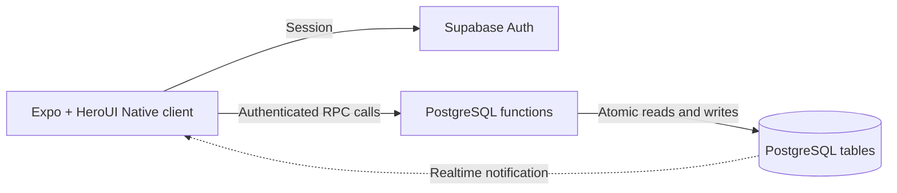

# CampusPool

*Product Requirements and System Design*

Islamabad Hack 2026  |  Version 1.2 — Native stack and QR pickup  |  Build window 9:30 AM to 6:30 PM PKT

### Product decision

Build a React Native mobile app using Expo, TypeScript and HeroUI Native that helps students leaving the same campus form a small group, split the cost of one externally booked car ride, and confirm their pickup. The first prototype serves one campus and a small set of shared destination hubs.

The user benefit is lower car travel cost with a clearly stated waiting time. Metro tickets remain individual purchases. A ride to a metro station can be pooled; the metro fare itself is never pooled.

### What this document enables

Use this brief to begin development at the event. It defines the screens, acceptance criteria, data model, transaction boundaries, fare rules, failure handling, test cases, and build sequence. It is a planning document; application development must happen on site.

### The demonstration

Three students request a ride to the same hub within overlapping departure windows. They form a group, see the estimated fare per person, and accept. One cancels; the estimate updates and the others must accept again. A replacement joins, the group locks, and members confirm pickup before the organiser marks the journey complete.

### Fixed scope

- One campus and one public pickup point; the exact BIIT gate must be confirmed locally.

- Two or three passengers per group, bounded by the actual vehicle and provider allowance.

- A common destination hub per group. Different drop offs and route optimisation are later work.

- External ride booking and direct settlement between students. No payments, provider API, or drivers inside this app.

- Authenticated demo accounts visibly labelled Demo student. Real campus verification is a pilot requirement.

### Reading order

This Markdown version supersedes the earlier web-stack Word document. The numbered sections below are the implementation reference; page numbers in the table refer to the original Word layout.

| Pages | Contents |
| --- | --- |
| 2 to 4 | Problem, scope, requirements, screens and acceptance criteria |
| 5 to 9 | Architecture, schema, transactions, matching and API contracts |
| 10 to 11 | Access control, failure handling and acceptance tests |
| 12 to 13 | Build schedule, demo and Kiro brief |

Schedule note: the organiser message names Saturday 10 October 2026. Confirm the event date rather than relying on the word tomorrow. The work plan below uses relative event times.

## 1 Product goals and boundaries

### Problem and primary user

Students leaving campus may pay for separate car journeys even when their destinations and departure times are compatible. CampusPool coordinates passengers before one student books a suitable ride elsewhere. The initial user is a campus student travelling to an agreed public hub, not a driver seeking fares.

Demand and willingness to pool remain hypotheses. Before building, ask five students what they paid for their last car trip, where they travelled, how long they would wait, and whether they would share with campus peers. Do not claim that every student needs car pooling or that a campus email guarantees trust.

### Value proposition

Find students going to the same hub, know the split before committing, and leave from one agreed pickup point. Route and departure details lead the interface; profiles are secondary. There is no profile browsing, swiping, or ongoing private messaging.

### Success criteria

| Measure | Hackathon target |
| --- | --- |
| Functional journey | Three separate authenticated sessions complete request, join, confirm, pickup and completion. |
| Matching latency | Suggestions return within 2 seconds on the small demonstration dataset; record observed latency. |
| Correctness | No duplicate membership or overfilled group under simultaneous joins. |
| Fare integrity | Displayed shares sum exactly to the entered total and are labelled estimates until confirmed. |
| Recovery | Cancellation changes membership and requires renewed consent to any changed estimate. |
| Presentation | Show one useful decision and one failure recovery in a 3 minute demo. |

### Scope levels

- P0 must ship: account login, request form, compatible groups, group acceptance, estimate calculation, cancellation, pickup confirmation, completion and persistent state.

- P1 only after P0 passes: group status updates via Realtime, map preview, group event history and basic report or block flow.

- Later: different drop offs, walking groups, live location, trusted contacts, campus administration, real verification, provider integrations and payments.

### Operating assumptions

Use fixed destination hubs and fixture travel times for the demonstration. Mark every fixture as illustrative. Confirm real pickup accessibility, hub coordinates, vehicle passenger capacity and applicable booking conditions before a pilot. Do not use logos or imply transport provider or campus partnerships without agreement.

## 2 User journeys and functional requirements

| ID | Requirement | Acceptance condition |
| --- | --- | --- |
| FR01 | Sign in | User has an authenticated session and a profile; demo affiliation appears as Demo student. |
| FR02 | Create a request | Choose campus, hub, earliest departure, latest departure and maximum estimated share. Reject invalid windows and duplicate active requests. |
| FR03 | Find compatible groups | Same campus, pickup and hub; departure windows intersect; no block relation; group is open and has space. |
| FR04 | Explain suggestions | Card shows departure, passenger count, estimated total and share, estimate source, and hub. |
| FR05 | Join or create | Joining adds exactly one member atomically. If no group exists, create one and display Waiting for another student. |
| FR06 | Confirm the estimate | Each member confirms the current group version. Membership or fare changes invalidate earlier confirmation. |
| FR07 | Lock for booking | At least two members, capacity respected, valid window, all current confirmations and all shares within limits. |
| FR08 | Confirm pickup | Organiser verifies each other member using their personal one-time QR token; all present before start. |
| FR09 | Cancel or leave | Before lock, reprice and reset confirmations. After lock, never silently rebook or add a stranger. |
| FR10 | Complete | Organiser records completion and an optional final total; app shows the split and does not claim payment occurred. |

### Account and request rules

Each student reserves one passenger place. Store departure timestamps in UTC and display Asia/Karachi. Allow future windows within the next 24 hours, 5 to 60 minutes wide. Suggested defaults are a 15 minute window and a configurable demonstration budget. One active request means searching, grouped, locked or in progress.

### No match and solo fallback

A student may remain waiting, change their window, choose another hub or cancel. Solo travel is an external fallback. Never imply that a pooled price is available with only one member, or that the app booked a vehicle when it did not.

## 3 Screens and interaction design

| Screen | Main content | Primary action |
| --- | --- | --- |
| Sign in | CampusPool purpose, login, demonstration label | Sign in |
| Request | Campus pickup, destination hub, time window, budget | Find a group |
| Suggestions | Compatible open groups, departure and labelled estimates | View group or create group |
| Group lobby | Pickup, hub, departure, members, split and confirmation status | Confirm current estimate |
| Booking handoff | Locked member list, organiser, external booking instructions | Record quoted fare |
| Pickup | Meeting point, personal QR, organiser scanner, member arrival status | Show QR or scan passenger QR |
| Journey | Group status and explicit organiser controls | Mark journey started |
| Summary | Final entered fare, personal share, estimate comparison | Finish |

### Suggested navigation

Use a single mobile column with a persistent trip status at the top. Put destination, departure and price ahead of names. Group member details appear after joining; suggestion cards display counts, not identifiable profiles. Use a small optional map rather than making every screen a map.

### Copy to use

- Estimated car fare PKR 900. Your estimated share PKR 300. Illustration only; book externally.

- Group changed. Review your new estimated share before confirming again.

- You are the organiser. Book a vehicle that permits this passenger count.

- QR confirmed: you have met the organiser of your matched group. This checks group membership, not identity or personal safety.

- No compatible group yet. Change your departure window or wait for another student.

### Interactive states

Every mutation has pending, success and failure states. Disable repeated taps while pending, but enforce idempotency on the server too. Show capacity conflicts as Group just filled. Refresh a stale lobby after version conflict. Use field errors for invalid windows and budgets; preserve form values on network failure.

### Accessibility and completion

Use labelled form controls, readable contrast, touch targets around 44 pixels, keyboard navigation, and status text in addition to colour. Show PKR without ambiguous currency symbols. Do not require geolocation; students select a fixed pickup and hub. Exclude live movement animation from the core journey.

## 4 System architecture

Use React Native and TypeScript with Expo and HeroUI Native for the client, Supabase Auth for sessions, PostgreSQL for durable state, and server side database functions for sensitive operations. Target Android first for the hackathon; test iOS only if a device or simulator is available. Realtime is an enhancement; manual refetch or foreground polling must also work. Use the official HeroUI Native scaffold on site and retain its compatible dependency versions.

| Layer | Responsibility |
| --- | --- |
| Expo + HeroUI Native client | Forms, suggestion cards, group screens, fare presentation and session handling. |
| Supabase Auth | Issues session tokens. Demo accounts use real authentication with fictional profiles. |
| Read RPCs | Return authorised, minimised suggestion and group views. Do not expose raw other student requests. |
| Mutation RPCs | Validate caller, enforce state transitions, lock rows and update membership plus events in one transaction. |
| PostgreSQL | Profiles, catalog, requests, groups, membership, quotes and events. |
| Realtime or polling | Notify client of authorised changes; client refetches canonical group state. |
| External provider | Student manually books outside CampusPool. No API integration is assumed. |

### Request and response path

The database is authoritative for capacity, prices, consent and state. Authorised updates notify other members to refetch; notifications are not the source of truth.

### Architecture decisions

- No separate Express server, Redis, microservices or optimisation service is needed for this prototype.

- Use fixed campus and hub identifiers. No geocoding or road routing dependency on the critical path.

- Implement matching as a filtered database query plus deterministic ranking.

- Calculate fares in integer rupees on the server; the native client may preview but never commit its own computed shares.

- Use real cross session persistence. A labelled local demonstration adapter is a fallback, not a claimed backend.

### Optional map

Use a lightweight map with catalog coordinates and pickup or destination markers. Any connecting line is schematic unless returned by a routing service. Keep attribution visible. If tiles fail, show named pickup and destination cards. Do not predownload OpenStreetMap public tiles for offline use.

### Native configuration and demonstration delivery

Use EXPO_PUBLIC_SUPABASE_URL and EXPO_PUBLIC_SUPABASE_PUBLISHABLE_KEY, plus an explicit demo UI flag. These values are bundled into the app and are public. Privileged secrets must never use an EXPO_PUBLIC prefix or enter the app bundle. Use a dedicated Supabase project over HTTPS. Use precreated email/password demo accounts to avoid deep-link and email delivery dependencies in P0.

Configure Supabase session persistence with the React Native storage adapter from its official quickstart, URL polyfill and AppState-controlled token refresh. Register lifecycle listeners once and clean them up. Refetch canonical group state when the app returns to the foreground; suspend polling in the background. Disable actions while refreshing an expired session and handle sign-out cleanly.

Demo on three independently authenticated devices or simulator instances. Confirm the generated Expo project works with the installed Expo Go version before relying on it. If dependencies need a development build, prepare that build early during the event. Use laptop screen mirroring for judging. An APK or development build is an optional delivery artifact; app-store publication is outside the hackathon. HeroUI Native's official quickstart currently advises against using it for web, so a browser demo is not the fallback.

### HeroUI Native implementation conventions

Use the scaffold's HeroUINativeProvider, GestureHandlerRootView, Uniwind and Tailwind setup. Keep safe-area padding and keyboard avoidance consistent across forms. Use React Native View, Text and ScrollView primitives and documented HeroUI Native component APIs; do not use DOM elements, web-only CSS or HeroUI React imports. Use a small navigation stack supported by the scaffold, adding navigation dependencies only if needed. Avoid complex sheets and animations on the critical path. Verify available components against the imported skill before choosing them.

The optional map is P1 and needs a mobile-compatible implementation verified on the target device. Named pickup and hub cards are the P0 route display. No location permission is required for fixed hubs. Do not add background location or push notifications to this MVP.

## 5 Database specification

All identifiers are UUIDs unless otherwise stated. Use foreign keys, timezone aware timestamps and constrained enum values. Tables below are implementation specifications, not prebuilt application code.

| Entity | Essential fields and constraints |
| --- | --- |
| profiles | id references auth.users; display_name; campus_id; affiliation_status demo or verified. Users cannot self grant verified status. |
| campuses and hubs | id; name; public coordinates. campus_pickups identifies allowed public meeting points. catalog_routes maps campus, pickup and hub to demo travel minutes and estimate. |
| ride_requests | id; user_id; campus_id; pickup_id; hub_id; earliest_at; latest_at; max_share_pkr; status; created_at. One active request per user via partial unique index. |
| ride_groups | id; campus_id; pickup_id; hub_id; organiser_id; capacity; departure_at; status; version; quote_id; locked_at. Capacity default 3, permitted 2 to 3 for demo. |
| group_members | id; group_id; request_id; user_id; status active or left; confirmed_version; pickup_confirmed_at. Unique active membership per user and request. |
| fare_quotes | id; group_id; total_pkr; source demo_estimate or organiser_quote or final_total; entered_by; created_at. Append records; do not overwrite quote history. |
| group_events | id; group_id; actor_id; event_type; minimal payload; created_at. No QR tokens or other secrets in payload. |
| pickup_secrets | id; membership_id; group_id; group_version; token_hash; expires_at; consumed_at; verified_by. One live token per membership. Issue opaque token once; regenerate explicitly if lost. Private table. |
| rpc_operations | user_id; operation_id; action; response reference. Unique user and operation pair. Persist with mutation for deduplication. |
| user_blocks | blocker_id; blocked_id; created_at. Unique pair; either direction excludes matching. Optional report stores reporter, group and text privately. |

### Relationships

Campus has pickup points; a catalog route connects a pickup to a hub. Each request belongs to one user. A group has multiple member records; each active member consumes one place and references a request. Quotes and events belong to a group. Personal QR tokens belong to membership records and the current locked group version.

### Indexes and derived data

Index open groups by campus_id, pickup_id, hub_id and departure_at. Index requests by user_id and status; memberships by group_id and active status; events by group_id and created_at. Derive active passenger count and current shares from authorised state. Avoid separately maintained seat counters that can drift.

## 6 State machines and transaction rules

| Group state | Allowed behaviour | Transition |
| --- | --- | --- |
| open | Join, leave, quote update, confirmation; capacity at most 3 | Lock when 2 or more members satisfy current consent |
| locked | External booking handoff; quote review and pickup | Start when current consent and all pickup confirmations hold |
| in_progress | No new members; no automatic regrouping | Organiser completes or cancels with reason |
| completed | Read only journey summary | Terminal |
| cancelled | Release non travelling active requests | Terminal |
| expired | Open group missed its departure window | Terminal |

### Request lifecycle

searching -> grouped -> locked -> in_progress -> completed. Leaving an open group returns a request to searching if its window remains valid; explicit cancellation makes it cancelled. When fewer than two passengers remain after lock, cancel the group and offer the remaining student a new search. Never count a left member as active.

### Atomic join

Within one transaction: authenticate caller; lock group row; lock caller request row; validate ownership and active status; check exact catalog route, time compatibility, capacity and block relations; add membership; mark request grouped; increment group version; clear all active confirmations; recalculate departure and split; append event. Persist operation records in the same transaction; retries with the same caller and operation ID return the existing result reference. Reject reuse with a different action or payload. QR token issuance is the explicit exception described under access control.

### Concurrency and consent

Every group mutation locks the group first, then affected request rows in UUID order. Create group locks the caller request before creating its new group. Use a unique active membership constraint as a final guard against joining different groups concurrently. Use expected_version for consent, locking, quote changes and leaving; a mismatch returns VERSION_CONFLICT with current state.

Joining can increase or decrease price shares. A user is not committed until they confirm the current version. Any membership, departure or quoted fare change increments version and clears consent. Locked groups do not accept replacements: cancel and reform if needed. On group reads and writes, expire an open group whose latest common departure has passed; no scheduler is required for the prototype.

### Quote and pickup changes

If an actual provider quote differs after lock, append a quote, increment version and reset confirmations while remaining locked. All members must reconfirm within their stated budgets before start. The organiser scans each passenger's personal QR. The server verifies the token against the current locked group and consumes it atomically. The organiser marks their own arrival separately. Both apps show the confirmed pairing and member arrival state. Membership or quote-version changes invalidate pending tokens and clear prior pickup confirmations; issue new tokens after renewed consent. QR verification is never a condition for exit or cancellation.

## 7 Matching and fare calculation

### MVP matching is compatibility first

Match only requests with the same campus pickup and destination hub. This avoids unsupported promises about overlapping road routes and multiple drop offs. The system coordinates a common ride; it does not solve a city wide transport optimisation problem.

- Candidate group must be open with available capacity and at least one active member.

- All departure windows must intersect: common earliest is the maximum earliest_at; common latest is the minimum latest_at. Reject if earliest exceeds latest.

- Proposed departure is max(current server time, common earliest). Reject if it exceeds common latest.

- Exclude any group with a block relation between the candidate and an active member.

- Preview the share after joining. Reject suggestions where any member would exceed their budget. Revalidate at join.

### Ranking and explanations

Sort eligible groups by predicted share after joining, then waiting minutes, then creation time and group ID for deterministic ties. Display Same hub, Leaves at 5:15 PM, 2 of 3 places occupied, and Estimate after you join. Group suggestions are tentative until the transactional join succeeds.

### Split rule

Let F be the total car fare in integer PKR and n the active passenger count. Each member receives floor(F/n); allocate the F mod n remaining rupees to members in stable membership order. Sum of shares must equal F. Everyone uses the same pickup and hub, so equal splitting is the MVP rule.

| Scenario | Total car fare | Passengers | Shares |
| --- | --- | --- | --- |
| Initial estimate | PKR 900 | 3 | 300, 300, 300 |
| One leaves before lock | PKR 900 | 2 | 450, 450; reconfirm |
| Provider quote changes | PKR 1,000 | 3 | 334, 333, 333; reconfirm |

### Savings definition

Illustrative saving per person = entered solo comparator fare minus that person's pooled share. Use a comparator for the same pickup, destination and time context. If no credible comparator exists, show only the split. Never equate a car fare with metro pricing, promise a saving against every alternative, or double count the group total as savings.

### Fare and capacity boundaries

Fixture fares are explicitly Demo estimate, not current market prices. The organiser enters an external quote manually; it is not an API verified booking. Capacity is a configured ceiling and must also satisfy the actual provider and vehicle limit. No surge, discounts, cancellations fees or payment settlement are automatically inferred.

## 8 API contracts and frontend organisation

Expose named RPC contracts through Supabase. Successful responses contain canonical group or request state. Mutations accept an operation_id UUID for retry deduplication. The contracts below define responsibilities; implement during the event.

| RPC | Inputs | Response or effect |
| --- | --- | --- |
| create_request | catalog IDs, time window, max share, operation_id | request_id and status; duplicate active request rejected |
| list_suggestions | request_id | Minimised group cards with current version and post join estimate |
| create_group | request_id, operation_id | Open group; caller becomes organiser and first member |
| join_group | group_id, request_id, operation_id | Atomic membership; updated version and shares |
| get_group | group_id | Authorised members, departure, quote, consent and event summary |
| confirm_estimate | group_id, expected_version, operation_id | Caller consent saved for current version |
| leave_group | group_id, expected_version, operation_id | Reprice open group or apply locked cancellation rule |
| set_quote | group_id, total_pkr, source, expected_version, operation_id | Organiser only; new quote and renewed consent |
| lock_group | group_id, expected_version, operation_id | Requires count, budget and consent checks |
| issue_pickup_qr | group_id, operation_id | Locked group, current consent, active non-organiser caller only; return opaque token and expiry once. Regeneration invalidates prior token. |
| confirm_pickup_qr | group_id, token, operation_id | Current organiser only; derive passenger from token; atomically consume and record arrival; return minimised passenger name and confirmation state |
| advance_group | group_id, target_status, expected_version, operation_id | Validated start, complete or cancel |

### Errors and refresh

Return stable codes: UNAUTHENTICATED, FORBIDDEN, INVALID_WINDOW, ACTIVE_REQUEST_EXISTS, GROUP_FULL, VERSION_CONFLICT, BUDGET_EXCEEDED, WINDOW_EXPIRED, BLOCKED_MATCH and INVALID_TRANSITION. Invalid pickup QR tokens return a generic failure without revealing any valid token. Rate-limit verification attempts per organiser and group (for example 10 failures per minute); enforce limits on the server. After any conflict, fetch the group again before offering an action.

### Suggested source layout

src/features/auth, requests, matching, groups and pickup; src/lib/supabase and money; src/components for shared UI; supabase/migrations for tables, constraints, grants and RPCs. Keep server validation separate from client forms. Add meaningful tests for fare arithmetic, eligibility, transitions and concurrent joining.

## 9 Access control and operational boundaries

### Authorisation model

Enable row level security on every exposed table. Direct client reads cover the caller's profile and requests plus the public catalog. Other student requests, secrets, reports and block lists stay private. Group reads require active membership; suggestion RPCs return only route, time, count and estimate, not names or contact details.

Prevent direct client writes to membership, group status, quotes, events, affiliation status and secrets. Use validated RPCs for these changes. Functions must derive caller identity from auth.uid(), never a supplied user_id. Grant execution only to intended roles. For security definer functions, set a safe search path, schema qualify objects and check membership and role explicitly; elevated execution must not substitute for authorisation.

### Credentials and identities

The mobile app uses a publishable key plus the authenticated user token. Never ship a service role key. Precreate fictional authenticated accounts in the dedicated demo project; do not put reusable passwords in a public repository. Campus verification remains a server managed field; a demo flag cannot confer verification. Avoid collecting student ID photos for the hackathon.

### Pickup and member privacy

### QR meeting flow

1. After locking and current fare consent, each passenger taps **Show my pickup QR**. The server generates a cryptographically random token with at least 128 bits of entropy. The client renders `campuspool:pickup:v1:<opaque-token>` as a QR. It contains no name, phone, email, address or credentials.
2. At the public pickup, the organiser taps **Scan passenger QR** and grants camera access. The passenger shows the QR on their phone; the organiser scans it.
3. The scanner validates the exact prefix and payload length, then sends the token to the authenticated RPC. It never opens arbitrary QR URLs. Disable duplicate scan callbacks while verification is pending.
4. The server requires the caller to be the current organiser, the group to be locked, both people to be active members, and current fare consent. It checks token expiry and group version, then consumes the token and marks passenger arrival in one transaction while locking group and token rows. A token from another group is rejected.
5. Both apps refetch server state. The organiser sees **Ayesha confirmed**; Ayesha sees **Connected with Sana, your group organiser**. The passenger can see the organiser's matched-group first name before showing the QR. This confirms the matched accounts met through the organiser's authenticated session; it cannot establish real-world identity or defeat intentional screenshot sharing.
6. Start is enabled only when every active passenger has confirmed pickup, the organiser has marked their own arrival, and all current consent and budget checks pass.

### Token lifetime and recovery

Store only a token hash in the private table. Expire each token after five minutes; explicit regeneration invalidates the old token. Never log raw tokens or persist them in event payloads, retry records or analytics. Keep the displayed token in memory and clear it on sign-out, backgrounding or leaving the screen; reissue when the passenger returns. A repeated issuance operation reports the existing issuance without replaying plaintext, then offers regeneration. Rate-limit issuance as well as verification.

Verification retries with the same operation ID return the original confirmation result. A consumed token submitted under a different operation ID is rejected without repeating arrival events. Do not mark arrival from a camera callback before the server accepts. On connection failure show **Not confirmed — retry when connected**. If camera permission is denied, show an explanation and settings/retry action; no silent manual bypass of QR verification. A labelled manual arrival fallback is a scope cut only, and the pitch must disclose it.

### Expo scanner implementation

Install `expo-camera` with `npx expo install expo-camera`. Use CameraView with QR-only barcode scanning and useCameraPermissions. Request permission only when opening the scanner. Unmount the camera when the screen loses focus; do not request microphone permission or save images. In a custom build configure camera permission text and disable audio recording permissions. Use a React Native-compatible QR renderer verified against the generated Expo project; keep token generation and verification on the server. Render with high contrast, a quiet zone and adequate size. Test scanning on physical phones; a simulator-only rehearsal does not verify the camera flow.

### Location and retention

Use public campus pickup points and destination hubs. Do not store home addresses, continuous GPS traces or public movement history. Remove demonstration profiles and trip data after judging unless the team needs the isolated dataset for continued development. Before a real pilot, specify retention, account deletion and contact sharing consent.

### Product boundaries

CampusPool is a passenger coordination prototype. It does not dispatch emergency services, guarantee a safe companion, book a provider ride, collect fares or verify payment. The organiser records booking state manually. A pilot needs campus participation, reporting procedures, verified affiliation, and confirmation that shared bookings are permitted. These are launch requirements, not extra features to promise in the demo.

## 10 Edge cases and acceptance tests

| Case | Expected behaviour |
| --- | --- |
| Two joins for final place | Exactly one succeeds; other sees GROUP_FULL. Active count never exceeds capacity. |
| Repeated submit or network retry | Same operation_id does not duplicate requests, members, quote or events. |
| Same user joins two groups | One active membership succeeds; second is rejected regardless of client state. |
| Window has no overlap | Group excluded and direct join rejected. Touching endpoints may match if departure has not passed. |
| Member budget too low | Suggestion filtered; confirmation or lock rejected when new quote exceeds any member limit. |
| Cancellation before lock | Membership released; quote split updated; version changes; all remaining consent cleared. |
| Organiser leaves open group | Oldest active member becomes organiser; if group empty, cancel it. |
| Cancellation after lock | No replacement added. With fewer than two members cancel group; otherwise reprice and reconfirm before start. |
| Updated fare after consent | Previous confirmation is stale; start blocked until all confirm current version. |
| QR token abuse | Wrong-group, expired, regenerated, stale-version and reused tokens rejected; unrelated user and non-organiser cannot verify. |
| Duplicate scan callbacks | One verification in flight; concurrent server submissions consume once and create one arrival event. |
| Camera or connectivity failure | Denial has settings/retry UI; offline scan never shows confirmed arrival. |
| Both-side confirmation | Organiser and passenger display the same server-confirmed group pairing after refetch. |
| Realtime disconnect | Refetch after reconnection; temporary polling or manual refresh preserves correct state. |
| Map or auth email failure | Named route remains usable; precreated demo accounts work independently of email delivery. |
| Unauthorised reads or writes | Other requests and private fields inaccessible; forged organiser or verified fields rejected. |
| Non divisible fare | For F=1000 and n=3, shares are 334,333,333 and sum to 1000. |

### Required verification before judging

Run matching and arithmetic unit tests, database integration tests for joining and state transitions, and a manual journey across three sessions. Exercise at least one simultaneous join and an unauthorised read with distinct user tokens. Check persistence after restarting each app and returning from the background, expired departure windows, cancellation and quote changes. Inspect the app bundle for privileged secrets.

### Testing boundary

Do not add elaborate end to end infrastructure if manual sessions and targeted integration tests cover the critical behaviours. If a feature does not work, remove the claim or label its demonstration explicitly. Network and provider booking reliability remain outside this prototype's guarantees.

## 11 Event implementation plan

Assume two or three teammates. Assign one person to database and RPC correctness, one to screens, and an optional third to integration, demo data and testing. With two people, split the third role. Integrate continuously against the same contracts; avoid independent mock flows that diverge.

| Time PKT | Deliverable and checkpoint |
| --- | --- |
| 9:30 to 10:00 | Confirm rules, team roles, pickup and hub scope. Create repo, Expo scaffold and Supabase project on site; launch on a device. |
| 10:00 to 11:15 | Implement schema, authentication, catalog and request form. Run the authenticated native shell on the target device. |
| 11:15 to 12:30 | Implement suggestions, create and atomic join. Prove two sessions see the same group. |
| 12:30 to 1:15 | Implement server split, confirmations, versions and cancellation. Integrate lobby. |
| 1:15 to 1:45 | Lunch buffer and inspect critical path. Cut optional features if matching is incomplete. |
| 1:45 to 3:00 | Locking, manual quote, pickup QR verification, start and completion. Complete first full journey. |
| 3:00 to 4:00 | Concurrency and access tests, failure states, foreground/restart recovery, keyboard handling and safe-area layouts. |
| 4:00 to 4:45 | Optional map or authorised Realtime only if P0 passes; prepare isolated demo fixture. |
| 4:45 to 5:30 | Rehearse 3 minute demo, write pitch, record fallback demonstration. |
| 5:30 to 6:30 | Final device/build check and judging buffer. Freeze features. Follow actual presentation schedule. |

### Cut order if behind

Drop map, Realtime, visual polish, event timeline and report UI in that order. Preserve authentication, matching, atomic membership, correct split and cancellation. If pickup QR verification are incomplete, retain an honest member arrival checklist and remove QR confirmation from the pitch. Never trade backend consistency for decorative movement.

### Before arriving

- Install Kiro and ensure laptop, charger, target phones, USB cables and account access are ready.

- Read this document and agree on P0. Discuss student demand and collect non sensitive route examples.

- Confirm the event date, presentation time and permitted preparation. Build application code only on site.

- Install the required mobile tooling and Expo Go where appropriate; verify account access. Agree on the Supabase project owner. Credits for Kiro are not assumed to fund unrelated services.

## 12 Demo script and Kiro handoff

### Three minute presentation

0:00 to 0:25: Explain the specific scenario: students leaving one campus pay separately for compatible car trips. CampusPool coordinates one shared ride with a transparent split.

0:25 to 1:10: Open three authenticated sessions. Each chooses the same demonstration hub with overlapping windows. Show group formation and the explicitly illustrative PKR 900 total becoming PKR 300 per passenger.

1:10 to 1:45: Cancel one member. The other shares become PKR 450 and confirmations reset. Add a replacement and reconfirm. Invite the judge to change a departure window and explain why an incompatible request is excluded.

1:45 to 2:30: Lock the group, record an external quote, confirm pickup QR verification and mark the ride started then complete. Show that the app coordinates the booking and settlement rather than processing either.

2:30 to 3:00: Explain one campus pilot, demand validation and the current limitation of common destination hubs. Name what you measured in testing; do not claim savings or safety outcomes from a fictional demo.

### Demonstration dataset

Use fictional names Ayesha, Sana and Bilal plus replacement Hamza. Set one public campus pickup and two illustrative hubs. Assign windows relative to the demonstration time so they do not expire before judging. Use PKR 900 as a labelled fixture, budgets at least PKR 450, and a capacity of three. A fourth concurrent join is rejected when full. Do not label real station coordinates unless checked.

### HeroUI skill setup for Kiro

This is an editor knowledge package, separate from the app dependency. Import it through Kiro's **Agent Steering & Skills → + → Import a skill → GitHub**, using the official skill folder:

https://github.com/heroui-inc/heroui/tree/main/skills/heroui-native

Kiro accepts a skill subdirectory URL and places imported skills in its skills directory. For project scope, confirm the installed folder is `.kiro/skills/heroui-native/` with `SKILL.md` and its supporting scripts. Invoke `/heroui-native` in Kiro to verify discovery. If importing fails, download the official skill folder and use Kiro's local-folder import. Do not assume a skill installed for another editor is automatically available in Kiro.

HeroUI also documents `npx skills add heroui-inc/heroui` as an installer. Kiro's explicit import is the preferred path for this team's IDE. Skill installation and reading documentation are preparation; run the app scaffold and develop the product on site.

### On-site scaffold checklist

1. Run `npx create-heroui-native-app@latest` and follow the prompts.
2. Enter the generated project and run `npm run start`.
3. Launch on the target device before adding product features; verify the provider, gestures and styles render.
4. Add Supabase's React Native client/storage dependencies using Expo-compatible installation. Follow the official Auth quickstart; do not add its example UI library because HeroUI Native supplies the UI.
5. Add public environment variables and authenticate two separate sessions before implementing matching.
6. Commit the lockfile and record generated dependency versions; avoid opportunistic upgrades during the event.

### Prompt to paste into Kiro at the event

Build CampusPool as a React Native TypeScript app using Expo, HeroUI Native and Uniwind, with Supabase Auth and PostgreSQL. Read this PRD and the heroui-native skill first. Use the official HeroUI Native scaffold and keep its compatible dependencies. Use native components, safe areas and keyboard handling; do not use Vite, DOM elements or HeroUI React. Target Android first. Configure persisted Supabase sessions, AppState token refresh and refetch on foreground. Demonstrate on independently authenticated devices or simulators. Implement P0 in vertical slices: authenticated requests, compatible group suggestions, atomic membership, server computed integer fare splits, versioned consent, cancellation, group locking, manual external quote, personal QR display, organiser camera scanning, server-side single-use QR verification and completion. Use one campus pickup and fixed destination hubs. Do not add drivers, payments, provider APIs, live GPS, chat, AI features or different drop offs. Label demo identities and fares visibly. Enforce all capacity, ownership and state rules on the server. Before each slice, state its acceptance criteria; after each slice, verify the complete user path. Keep privileged keys out of the frontend. Begin with schema and API contracts, then implement one working journey before optional styling or maps.

### Technical references

Expo Camera and QR scanning  https://docs.expo.dev/versions/latest/sdk/camera/

HeroUI Native quickstart  https://heroui.com/en/docs/native/getting-started/quick-start

HeroUI Native agent skills  https://heroui.com/en/docs/native/getting-started/agent-skills

Kiro skill import  https://kiro.dev/docs/skills/

Supabase React Native authentication  https://supabase.com/docs/guides/auth/quickstarts/react-native

Supabase database functions  https://supabase.com/docs/guides/database/functions

Supabase row level security  https://supabase.com/docs/guides/database/postgres/row-level-security

Supabase Realtime changes  https://supabase.com/docs/guides/realtime/postgres-changes

OpenStreetMap tile policy  https://operations.osmfoundation.org/policies/tiles/

Kiro first project workflow  https://kiro.dev/docs/getting-started/first-project/
